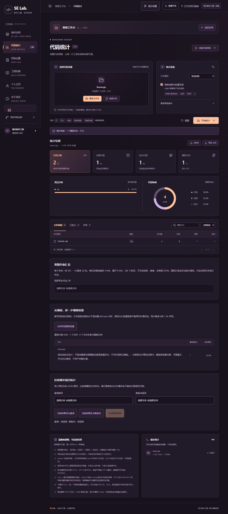

# SE Lab · 软件工程实践平台


[](https://github.com/coder9231/modern-software-engineering-project/actions/workflows/ci.yml)
[](package.json)
[](LICENSE)
[](scripts/test-workspaces.mjs)

围绕《现代软件工程》课程，把需求、实现、测试与团队协作放进一个可运行的项目：统计项目代码，制作与批改四则运算练习，并展示工程实践与个人成果。

**本轮交付仓库源码、CI 与 Docker 配置，保留现有线上站点，不自动部署。** [现有演示站](https://se-practice-coder9231.a0910663736.chatgpt.site)与当前仓库可能不同步；访问演示站不代表下面所有新增能力已经上线。构建徽章展示 GitHub 工作流状态；覆盖率徽章表示门禁要求，不表示某次实测百分比。

## 五分钟本地启动

需要 Node.js **22.22.1 或以上**和 npm。所有命令都在仓库根目录执行；依赖由 npm workspaces 与根目录唯一的 package-lock.json 管理。

```powershell
npm ci
npm run ocr:prepare
npm run dev
```

打开 [http://localhost:5173](http://localhost:5173)。在首页或导航中选择“代码统计”或“四则运算”。开发模式首次编译与本机 OCR 初始化可能需要等待。

本机服务运行时可直接进入：[创作空间](http://localhost:5173/#overview)、[代码统计](http://localhost:5173/#counter)、[四则运算](http://localhost:5173/#math)。这些入口在运行服务的电脑上生效；GitHub 仓库页用于查看与下载源码。

```powershell
npm run build
npm start
```

上面两条命令构建并在本地 Worker 环境运行产物。不要进入历史 website 目录单独安装；新功能以 packages/ 中的实现为准。

## 可以做什么

| 使用场景       | 仓库中的能力                                                                         | 操作入口                             |
| -------------- | ------------------------------------------------------------------------------------ | ------------------------------------ |
| 观察项目规模   | C/C++、Java、JS/TS、Python、Go、Rust、C#、CSS、JSON 物理行统计、筛选与 JSON/CSV 导出 | “代码统计”→“选择文件夹”→“开始统计”   |
| 观察代码变化   | 教学用复杂度估计、纯注释率、规范化片段重复率；两份 JSON 行数报告比较                 | “分析所选源码质量”“比较两次项目统计” |
| 汇总班级作业   | 每人一份 ZIP，逐份统计并导出全班 CSV                                                 | “班级作业汇总”                       |
| 老师备课       | 7 组可编辑教学参考预设、最多 10000 题、固定种子、试卷与独立答案卷打印                | “四则运算”→“出题与练习”              |
| 学生练习       | 精确分数批改、计时、练习记录、错题筛选与原题重练                                     | “提交整卷批改”“错题本”               |
| 挑战与识别     | 24 点限时关卡与本地榜单；本机印刷体 OCR、可选 AI OCR、人工核对后批改                 | “24 点挑战”“拍照改卷”                |
| 阅读与操作辅助 | 高对比度、静态画面、系统减少动态效果支持、页面错误恢复入口                           | 页面辅助设置与错误提示               |

教学预设覆盖小学一至六年级和初中有理数，是可调整的示例，不代表官方课标。质量指标用于发现值得检查的代码，不能替代评审或判定抄袭。报告比较按路径与行数进行，不能识别等行数修改或文件重命名。

<details>
<summary>查看工作台与移动练习截图</summary>

桌面代码统计使用自有合成 `lesson.go` 样例：



移动练习使用随机生成算式，班级与姓名保持空白：


截图对应本轮本地版本；现有线上演示站可能仍运行旧版。

</details>

300 题及以上采用 NDJSON 流式出题，每批最多 32 题，显示进度与预览，支持取消；服务器设 30 秒期限，页面另有超时保护。只有完整生成成功后才替换当前练习，取消、超时或题空间不足时保留原卷。生成一万道题不等于支持一万并发用户。

## 按角色阅读

- [教师指南](docs/guides/teacher.md)：选预设、出卷、独立答案卷、班级 ZIP 汇总。
- [学生指南](docs/guides/student.md)：作答、错题重练、24 点与拍照改卷。
- [开发者指南](docs/guides/developer.md)：工作区、命令、接口、质量门禁与容器运行。
- [常见问题](docs/guides/faq.md)：存储、隐私、超时、OCR 与线上版本。
- [架构说明](docs/architecture.md)：依赖关系、关键时序、数据边界与取舍。
- [本轮优化状态](docs/upgrade-status.md)：路线图进度、复查命令与尚待验收的范围。
- [贡献指南](CONTRIBUTING.md)、[团队协作](docs/team.md)：认领任务、评审与建议节奏。

## 常用命令

```powershell
npm run verify
npm run test:coverage
npm run test:e2e
npm run bench
npm run cli:bundle
npm run cli:native
```

verify 检查工作区依赖边界、严格类型、lint、格式和单元/服务测试；test:coverage 对 core 的行、分支、函数分别设 **90%** 门禁。E2E 配置包含桌面 Chromium、Firefox、WebKit 与 Chromium 手机视口，需要安装相应浏览器；配置存在不表示这些浏览器已全部实测。bench 输出当前机器测量到 reports/，结果不是生产服务承诺。详见[开发者指南](docs/guides/developer.md)。

根目录安装后可直接运行 CLI：

```powershell
node packages/cli/src/code-counter/cli.mjs . --details
node packages/cli/src/code-counter/cli.mjs . --json --output reports/code-count.json
node packages/cli/src/arithmetic/cli.mjs --count 300 --seed course-weekly --answers
node packages/cli/src/arithmetic/cli.mjs --count 300 --seed course-weekly --json --answers --output reports/worksheet.json
```

代码统计 CLI 的 --output 会覆盖指定报告文件；四则运算 CLI 只新建文件，存在同名文件会拒绝写入。cli:bundle 生成 packages/cli/dist/se-count.mjs 与 se-math.mjs，仍需 Node.js。cli:native 使用 Node 24 SEA 构建包含运行时的单文件程序；Windows x64 已完成空 PATH 独立目录帮助/JSON 检查，产物未做发行者签名。macOS 仅提供同机 arm64 构建路径，未实测；平台、签名与证据见[原生 CLI 交付](docs/native-cli.md)。

## 数据如何处理

选择文件不会自动上传。开始代码统计或质量分析后，所选源码会分批发送到本站对应接口；源码不执行、不做持久保存。班级 ZIP 在浏览器解包，符合条件的源码发送到统计接口。普通报告导出可能把统计结果交给本站格式化；大报告与差异报告在浏览器生成。

练习生成发送规则与种子；批改发送算式与作答，服务器重新计算答案。练习摘要、错题本和 24 点榜单只存当前浏览器，没有账号、班级共享或云同步；错题重练后的批改仍会发送本次题目与答案。标题、班级、页脚用于本地打印。

“本机印刷体”用同站点准备的 Tesseract.js 资源在设备内处理图片，不把图片发送到 OCR 服务。它**不适合可靠识别手写**，结果必须逐行校正。“可选 AI 服务”只有配置服务端密钥与访问码后才启用；点击“上传并识别”会把图片经本站发送给 OpenAI。两种方式批改时都会把核对后的文本发给本站数学服务。[详细边界与清理方式](docs/guides/faq.md)。

## 交付与验收边界

仓库提供 Dockerfile、compose.yaml 与 CI；容器配置使用非 root 用户、健康检查，并将本机 8080 端口绑定到回环地址。可运行：

```powershell
docker compose up --build
```

打开 [http://localhost:8080](http://localhost:8080)。本轮机器没有 Docker 命令，未完成容器实跑；CI 已配置镜像构建与健康检查任务，尚无本轮远端运行结果。

2026-11-03 本地完整 verify 与生产构建通过；239 项测试中 233 通过、6 跳过，核心行/分支/函数覆盖率均超过 90%。Edge 桌面与 Chromium 手机模拟 10/10 项 E2E 通过，生产 Worker 的 9 项 HTTP 检查通过。具体范围与本地证据位置见[优化状态](docs/upgrade-status.md)。

仍待验收：其他浏览器与实体设备、完整读屏/对比度、实际打印分页、更多印刷体样本、可选 AI 与真实手写、目标环境 Docker 及远端 CI。本机 OCR 样例出现多字，需人工校正；流程通过不表示识别逐字准确。历史测试记录只证明其对应版本。[已有验证记录](docs/arithmetic-test-results.md)与[界面记录](docs/spatial-interface-test-results.md)继续保留。

## 目录与历史资料

```text
packages/
  core/       浏览器与 Node 共用算法，严格 JSDoc + checkJs
  cli/        文件扫描、命令行和单文件打包入口
  web/        React / Vinext 页面、Worker API 与资源
  ocr/        本机 Tesseract 与可选服务端 AI 适配器
scripts/      统一检查、OCR 资源准备、基准与打包
tests/e2e/    浏览器流程检查
docs/         需求、决策、指南、学习与验证记录
```

website/ 与 tools/ 保留历史资料和兼容入口；新增实现位于 packages/，不要维护两套业务算法。历史第 3～7 版的发布与界面演进见[四则运算记录](docs/arithmetic-test-results.md)、[宇宙导航记录](docs/universe-test-results.md)、[空间界面记录](docs/spatial-interface-test-results.md)。其他入口：[需求](docs/requirements.md)、[四则运算需求](docs/arithmetic-requirements.md)、[设计决策](docs/decisions/)、[课程学习笔记](docs/learning-notes.md)。PPT 学习资料仅保留在维护者本地，不随公开源码分发。

项目自有源码与文档采用 [MIT](LICENSE)，第三方依赖与课程材料范围见[许可说明](THIRD_PARTY_NOTICES.md)。本地 testcase1–testcase3、reports/、原始课堂资料与课件转录不随公开源码分发；截图与测试报告保留本地时也不要误加入提交。
