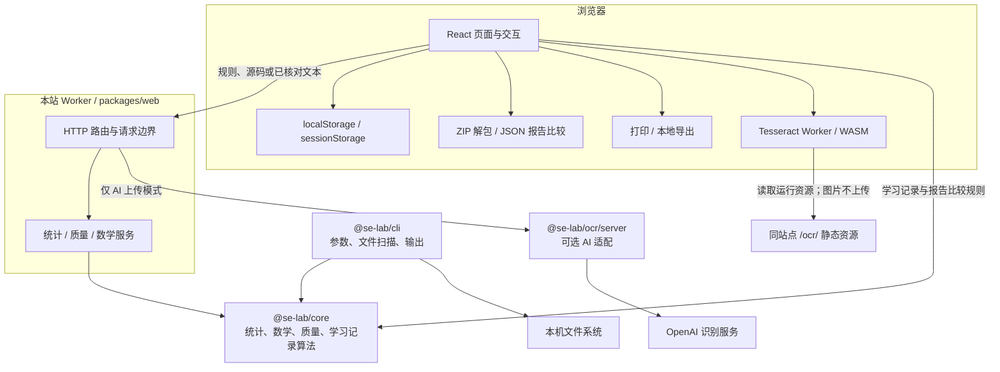
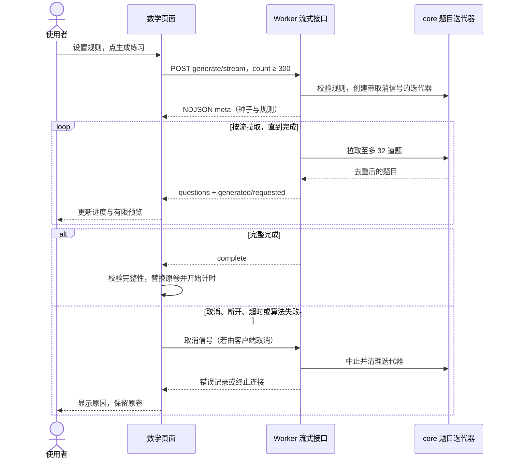
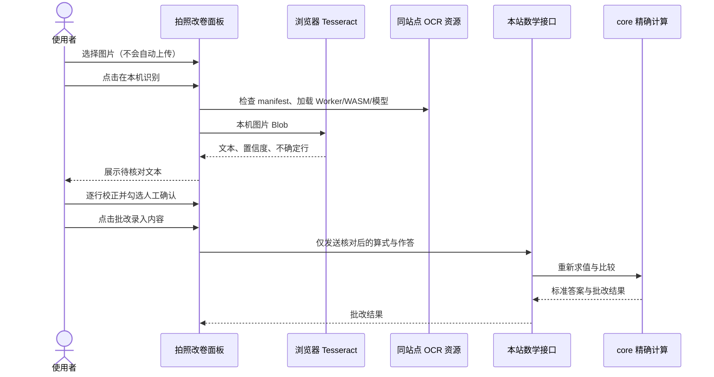
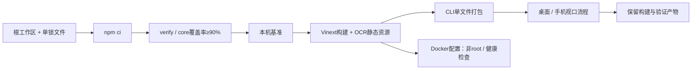

# 架构说明

本说明描述 packages/ 中的当前实现；历史设计决策继续保留在 [decisions/](decisions/)。本轮交付源码、CI 与 Docker 配置，不更新现有线上站点。

## 组件与依赖

箭头表示调用/数据方向；core 不依赖 web、cli 或 ocr。web 使用 core 与 ocr 的公开包导出；ocr 可以使用 core，不反向依赖 web。相对路径不能跨工作区，scripts/check-boundaries.mjs 检查方向与 core 的文件系统依赖限制。

| 工作区 | 职责                                                                                           | 不承担的状态                            |
| ------ | ---------------------------------------------------------------------------------------------- | --------------------------------------- |
| core   | 精确有理数、解析/RPN、题目生成/去重、24 点；语言词法统计；教学质量估计、报告比较；学习记录校验 | 无浏览器 UI、HTTP、文件扫描、账号数据库 |
| cli    | 命令参数、目录扫描、编码、文件输出与退出码                                                     | 不复制数学或词法业务算法                |
| web    | 交互、Worker API、请求校验、分批传输、流式响应、错误与取消处理                                 | 不持久保存上传源码或建立班级账号        |
| ocr    | 本机 Tesseract 资源调用和文本清理；可选 AI 请求、访问码与响应校验                              | 不把识别置信度当成最终批改结论          |

## 单一源码与契约

根目录 npm workspaces 管理四包与一个 package-lock.json。packages/ 是业务实现来源；website/ 与 tools/ 保留薄兼容入口和历史资料，不形成另一套算法。

core 保留 JavaScript .mjs 实现，通过严格 JSDoc/checkJs 做静态检查，.d.mts 描述公开契约，类型样例检查消费者。这样 CLI、Worker 与浏览器可共享同一算法；代价是改公开字段时必须同步实现注释、声明、调用方和有效验证。声明文件不是对运行时输入的校验替代。

统计规则是总物理行 = 代码 + 纯注释 + 空白；混合行计代码。JS/TS 在预算内使用 Babel 解析词法上下文，超预算/无法解析时回退扫描；C/C++ 续行保留物理行映射，Python 文档字符串仍计代码。Go/Rust/C# 使用对应词法状态。它是统计器，不执行、编译或完整校验程序。

数学以调度场算法转为 RPN，用精确有理数计算；按规范化结构去重，种子与规则支持复现。服务器批改从算式重新计算，不信任浏览器附带的答案。题空间不足、尝试上限和取消属于显式失败，不能静默返回少题的正式卷。

## 关键时序：大题量生成

小于 300 题走普通 JSON 接口；300 题及以上走 NDJSON。服务端 30 秒期限，页面 35 秒保护；生成器按需生产，避免先构造一整份结果再假装逐块发送。客户端校验 meta、题目数量与 complete，局部预览不能进入正式练习。UI 每页 12 题，批改提交整卷。

## 关键时序：本机 OCR 与人工批改

本机图片不进入 OCR 网络请求；运行资源仍来自同站点，不能因此称整个网站完全离线。Tesseract 针对清晰印刷体，不适合可靠手写识别，真实印刷体也可能出现多字、漏字或符号错误。人工校正后的批改流程通过，不等于原始识别逐字准确。

可选 AI 模式是另一条显式路径：用户输入访问码→点击上传→本站校验配置/请求→图片转发 OpenAI→结构化转录→人工校正与确认→本站数学批改。API 密钥仅在服务端；没有配置时禁用 AI 按钮，保留本机与手动录入。真实 AI、手写准确率、延迟与成本需独立验收。

## 数据与资源边界

| 路径           | 浏览器处理                            | 发给本站                       | 持久化                          |
| -------------- | ------------------------------------- | ------------------------------ | ------------------------------- |
| 代码统计       | 文件选择、分批、展示                  | 相对路径、源码 Base64、选项    | 不保存源码；最近 4 条摘要在本地 |
| 质量分析       | 发起/取消、展示                       | 所选源码与选项                 | 结果只在当前页面                |
| JSON 报告比较  | 导入、校验、按路径/计数比较、差异导出 | 比较本身不发送报告             | 当前页面；下载文件由用户保管    |
| 班级 ZIP       | 有界解包、逐份进度、全班 CSV          | 符合条件的源码批次             | 汇总在页面；导出本机            |
| 数学出题与批改 | 规则、作答、分页、计时                | 规则/种子，或算式与作答        | 50 条摘要、500 道错题在本地     |
| 24 点          | 表达式、限时、本地榜单                | 新题/求解/验证所需字段         | 最多 30 项成绩在本地            |
| 本机 OCR       | 图片、Worker、校正                    | 读取静态资源；批改发送文本     | OCR 面板不存历史                |
| 可选 AI OCR    | 图片选择、访问码、校正                | 图片与访问码，服务端再转发图片 | 面板内存；本站不建立识别历史库  |
| 打印与显示偏好 | 标题/班级/页脚、打印、主题            | 打印字段不上传                 | 偏好在本地，打印文件由用户保管  |

正常报告导出可能将统计报告交给本站格式化，大报告与差异报告在浏览器生成。localStorage 是当前浏览器与当前站点的数据，不是身份隔离或云备份；可因清理、配额、隐私模式而不可用。恢复失败会提示并跳过无效记录，不阻断本次练习。错误边界可重开页面，但不能恢复未保存输入。

## 有界工作与失败处理

源码批次为最多 100 文件/4 MiB，单文件 4 MiB，HTTP 请求体另有实际字节上限；路径必须为受限相对路径。自动编码识别 BOM，否则严格 UTF-8，可显式选 GB18030。质量分析另限 1 Mi 字符；不支持可靠估计时返回不可用/警告，避免把扫描结果冒充完整控制流分析。

每次最多 20 个 ZIP，每包压缩 4 MiB、展开 8 MiB、200 条目、32 层；拒绝路径穿越、链接、加密、多卷与 ZIP64。支持取消，保留已完成汇总行。限制用于控制资源和反馈失败，不是大规模生产容量证明。

复杂度是文件级词法启发式，重复率是规范化片段匹配；两份行数报告比较不识别等行数修改和重命名。这些限制应在界面、指南和验收中保持一致。

## 构建、验证与交付

CI 检查与 Docker 配置不包含本轮自动部署；现有站点继续保留。原生 CLI 通过独立 Node SEA 构建，见[交付说明](native-cli.md)，与依赖 Node 的 ESM bundle 区分。

覆盖率门禁为 core 行、分支、函数分别 90%，不是整个 UI 的覆盖率。基准只测指定机器与任务，不代表生产并发。浏览器脚本存在也不等于当前提交执行通过；Chromium 手机视口不等于其他浏览器或实体设备。

交付证据应记录对应提交或工作区状态、Node/浏览器/系统、实际命令与结果。[本轮优化状态](upgrade-status.md)列出目前证据范围。完整复测、跨浏览器、真实打印、目标机器 Docker、可选 AI 与真实手写样本均须各自验收，历史报告不能替代。
